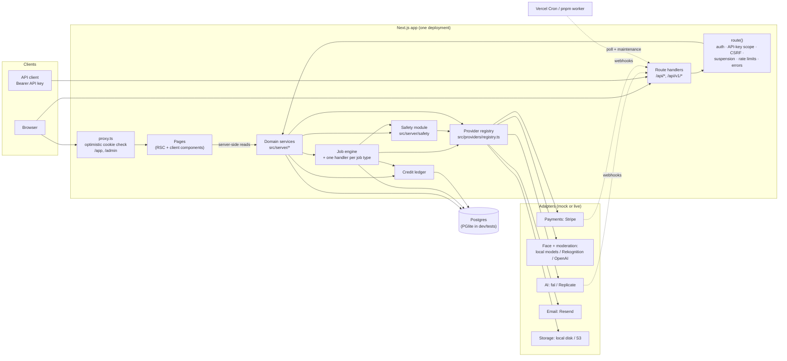
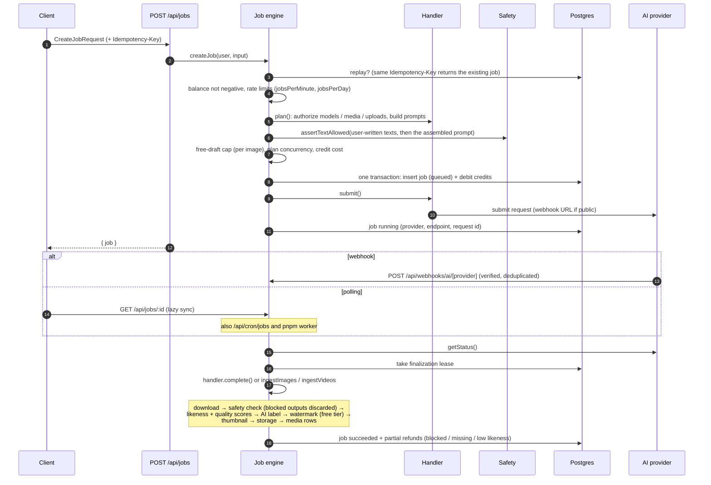
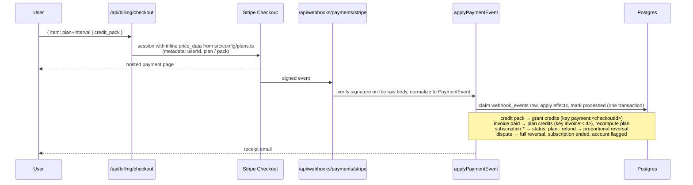

# Architecture

OpenShoot is a single Next.js 16 application (App Router) backed by Postgres and object storage. There is no
separate queue, cache or microservice: background work is a Postgres-backed job table driven by provider webhooks,
lazy polling, Vercel Cron or a worker process. Everything external sits behind an adapter interface, so the whole
app runs on mocks with zero keys.

This document explains how the pieces fit. Contracts (signatures, conventions, the full route list) are in
[CONTRACTS.md](CONTRACTS.md); product behavior is in [SPEC.md](SPEC.md); the reasons behind non-obvious choices are
in [DECISIONS.md](DECISIONS.md).

## Overview



- **`src/proxy.ts`** (Next 16's replacement for middleware) only redirects visitors without a session cookie away
  from `/app` and `/admin`. It is not an authorization layer.
- **`route()`** in [`src/server/http.ts`](../src/server/http.ts) wraps every API handler. It resolves the caller
  (session cookie or API key), enforces the auth mode (`public`, `user`, `admin`, `api`, `user_or_api`), checks API-key
  scopes, refuses cross-site cookie-authenticated writes (`Sec-Fetch-Site` / `Origin`), blocks suspended accounts,
  applies the route's rate limits, awaits Next 16's async `params`, and turns `AppError`s into
  `{ error: { code, message, details? } }` JSON.
- **Domain services** (`src/server/<area>/`) hold all business logic. Pages call them directly on the server; route
  handlers stay thin. Every query on user data filters by the owner's `userId`.
- **Adapters** are picked by [`src/providers/registry.ts`](../src/providers/registry.ts) from the validated
  environment ([`src/lib/env.ts`](../src/lib/env.ts)). See [ADDING_PROVIDERS.md](ADDING_PROVIDERS.md).

## Job lifecycle

All generation work (train, generate, pose copy, edit, inpaint, upscale, face restore, background removal, video,
talking video, try-on, multi-person) goes through one engine,
[`src/server/jobs/engine.ts`](../src/server/jobs/engine.ts), and one handler file per type in
[`src/server/jobs/handlers/`](../src/server/jobs/handlers). `POST /api/jobs` (and `/api/v1/jobs`) takes a Zod
discriminated union on `type`; `train` jobs come from `POST /api/models/:id/train`, batches from `POST /api/batches`.



Details worth knowing:

- **Charging.** The credit debit (`debitForJob`) happens in the same transaction as the job insert. Costs come from
  `creditCost()` in [`src/config/credits.ts`](../src/config/credits.ts), or `JobPlan.credits` when the handler
  overrides it (instant-mode models cost 2×). A submit error fails the job and refunds it immediately.
- **Statuses.** `queued` → `running` → `succeeded` | `failed` | `canceled` | `blocked` (every output was blocked).
  Every terminal transition is a conditional update from `queued`/`running`, so it happens once.
- **Completion sources race safely.** Provider webhooks, the lazy sync in `GET /api/jobs/:id`, `/api/cron/jobs`
  (Vercel) and `pnpm worker` (Docker) can all reach the same job. Polling is throttled per job with a claim on
  `last_polled_at` (every 3 s without webhooks; every 20 s, 60 s for training, when webhooks are on, since polling is
  then only a fallback). Only the holder of a **finalization lease** (`jobs.output.finalizing`, 5 minutes) downloads
  and ingests outputs. If the lease is lost (job canceled, or a crashed worker's lease expired and another took
  over) the stored media is deleted.
- **Retries.** Ingestion is retried up to 3 times with backoff; errors marked non-retryable (bad output) fail the job
  at once. Jobs still `queued` after 10 minutes, or running past 2 hours (training: 6 hours), are failed by
  `pollStaleJobs()`.
- **Refunds.** `failJob()` refunds whatever is left of the charge. Blocked outputs, missing outputs and outputs below
  the likeness guarantee (`LIKENESS_GUARANTEE_THRESHOLD`, 0.45) are refunded proportionally; refunded low-likeness
  photos are discarded, not kept. Refunds use ledger
  idempotency keys per tag and are capped at the amount charged, so concurrent paths can never over-refund.
- **Batches.** `createBatch()` creates one child job per image (up to 50, plan `maxBatch`), each charged
  individually, and stops early on `insufficient_credits`. A batch occupies one concurrency slot. The batch's
  `Idempotency-Key` is stored on its children as `<key>:<i>`.
- **Training.** The train handler runs the final safety gate, zips the accepted (EXIF-stripped) photos into
  storage, hands the provider a URL, and on completion stores `identity_models.providerModelRef` and emails the
  user. fal LoRA files are also copied into storage under the model's prefix (`weights/{jobId}-{attempt}.safetensors`,
  [`src/server/models/weights.ts`](../src/server/models/weights.ts)) and generation uses that copy, because fal has no
  file-deletion API (its copy expires after a day). The zip is deleted when the job ends. Instant models skip
  training: they reference the training photos directly (`IdentityRef.referenceImageUrls`) and are ready
  immediately.
- **Provider inputs.** `providerInputUrl()` returns a short-lived signed URL when storage is publicly reachable (S3,
  R2), and otherwise uploads the bytes to the provider's own file storage (local disk in development, or an S3
  endpoint on `localhost` / a private network such as the Compose MinIO).

## Safety pipeline

The safety module ([`src/server/safety`](../src/server/safety), policy in [SAFETY.md](SAFETY.md)) is called at
fixed points and has no off switch:

| Stage | Check | Function |
|---|---|---|
| Model creation | Live consent selfie from the camera with a single-use capture token and a random head-pose challenge: one adult face, not a public figure, not sexual; stores the consent embedding | `verifyConsentSelfie`, `liveness.ts` |
| Training photo upload | Exactly one face, matches the consent embedding, estimated age ≥ 20, not sexual. Failures are rejected with 422 and never stored | `analyzeTrainingPhotoSafety` |
| Training start | Ownership, consent present, enough photos, every photo matched and adult (re-analyzed if needed) | `assertTrainingAllowed` |
| Job creation | Rule-based filter + moderation provider on every user-written text (prompts, instructions, scripts) | `assertTextAllowed` |
| Job creation | Every identity owned by the user or shared through an accepted, unexpired invite | `assertModelsUsable` |
| Reference / garment / mask upload | Classifier, no minors, no public figures (when supported) | `assertReferenceImageAllowed` |
| Output ingestion | Classifier plus an age gate (every face estimated 20+) on every image and on sampled video frames (1 per second, up to 32); blocked outputs are discarded before storage and refunded | `checkOutputImage`, `checkOutputVideo` |
| Output ingestion | Likeness score against the identity (best-shots picker, likeness guarantee) | `likenessScore` |

Every block is recorded in `moderation_events` (hashes and short excerpts, never the bytes) for the admin moderation
queue. Every check fails closed: a provider error blocks. Generated media only flows into edits, upscales, videos and
try-ons for the same user (DECISIONS #11), and every stored output gets IPTC `trainedAlgorithmicMedia` metadata
(XMP for images, MP4 tags for videos) plus a visible watermark for free users who never paid.

## Data model

27 tables in [`src/db/schema.ts`](../src/db/schema.ts) (Drizzle, `snake_case` columns, text columns with TypeScript
unions instead of Postgres enums). Migrations are SQL files in [`drizzle/`](../drizzle).

| Area | Tables | Notes |
|---|---|---|
| Auth (Better Auth) | `user`, `session`, `account`, `verification` | `user` also holds `role`, `banned`, `credits` (cached balance), `plan`, `hasPaid`, the payment customer id and `deletedAt` |
| Identity | `identity_models`, `training_photos`, `consent_records`, `model_shares` | Mode (`instant` / `trained`) in `identity_models.metadata.mode`; status `awaiting_consent` → `collecting` → `training` → `ready` (or `failed`, `deleting`) |
| Work | `jobs`, `batches` | `jobs.input` is the validated request, `jobs.output` holds the plan, media ids and the finalization lease |
| Media | `media`, `uploads`, `folders`, `share_links` | `media` rows point at storage keys; scores, hidden flag, favorites |
| Safety | `reports`, `moderation_events` | Abuse reports and every blocked request |
| Money | `credit_ledger`, `subscriptions`, `payments`, `webhook_events` | Append-only ledger with unique idempotency keys; `webhook_events` deduplicates AI and payment webhooks |
| Platform | `api_keys`, `rate_limits`, `email_outbox`, `deletion_requests` | API keys and deletion tokens are stored as SHA-256 hashes; rate limits are fixed windows in Postgres |
| Teams | `teams`, `team_members`, `brand_kits` | Studio plan |

Packs are not in the database: they are JSON files in `packs/` read at runtime by
[`src/server/packs/registry.ts`](../src/server/packs/registry.ts) (DECISIONS #17).

`DATABASE_URL` accepts `postgres://…` (postgres.js; prepared statements are disabled automatically for transaction
poolers) or `pglite:./path` / `pglite:memory` (embedded Postgres for development and tests).

## Storage layout

Every object key is built by `storageKeys` in [`src/server/storage/index.ts`](../src/server/storage/index.ts), and
everything a user owns lives under one prefix, so account deletion is a single prefix delete:

```
users/{userId}/
  models/{modelId}/
    consent/{id}.jpg              consent selfie
    photos/{photoId}.jpg          training photo (EXIF stripped)
    photos/{photoId}_thumb.webp
    training/{jobId}.zip          training set, deleted when the job ends
    weights/{jobId}-{attempt}.safetensors   copy of a fal-trained LoRA (fal can't delete its own copy)
  media/{mediaId}.{ext}           generated image or video (AI-labeled, watermarked on the free tier)
  media/{mediaId}_thumb.webp
  uploads/{uploadId}.{ext}        pose references, garments, masks (deleted after 30 days)
  uploads/{uploadId}_{w}x{h}.png  mask resized for a job
```

Two drivers implement `StorageProvider`: `local` (files on disk, served by `GET /api/files/[...key]` with HMAC-signed,
expiring URLs and Range support) and `s3` (any S3-compatible service, presigned URLs). Buckets stay private; users,
browsers and AI providers only ever receive short-lived signed URLs. Keys are validated against path traversal.

## Authentication and authorization

- **Sign-in** uses [Better Auth](https://www.better-auth.com) ([`src/server/auth/auth.ts`](../src/server/auth/auth.ts))
  with magic links (15-minute, single-use, stored hashed) and optional Google OAuth. Emailed links open `/verify`,
  which consumes the token only when the user clicks, so link scanners can't burn it (DECISIONS #25). Email and
  password sign-in is off.
- **Sessions** are cookies valid for 30 days. There is no cookie cache: every request reads the session row, so
  sign-out and revocation apply at once. Suspended or deleted accounts are refused when a session is created, and
  `route()` re-checks suspension on every request.
- **Admins** have `user.role = "admin"`: set by `ADMIN_EMAILS` for verified addresses (applied at sign-up and at each sign-in) or by the
  seed script (`SEED_ADMIN_EMAIL`). Admin routes use `auth: "admin"`; admin pages call `requireAdminPage()`.
- **API keys** (`/app/api-keys`) are shown once and stored as SHA-256 hashes, carry scopes (`*`, `read`,
  `generate`), need a plan with `apiAccess`, and are rate limited per key (`apiPerMinute`) on top of per-account
  limits.
- **Ownership** is enforced in services: `getOwnedModel`, `getOwnedMedia`, `getOwnedUpload` and user-filtered
  queries. Unknown and foreign ids get the same `not_found` (or `forbidden` for multi-person) answer.

## Billing flow



- [`src/server/billing/service.ts`](../src/server/billing/service.ts) starts checkouts and portal sessions;
  [`events.ts`](../src/server/billing/events.ts) is the only place payment state changes. Events are idempotent
  (event id and ledger keys), safe out of order (older subscription updates are ignored, `canceled` is terminal) and
  redelivered by the provider when they fail (HTTP 500) or are still being applied by another request (HTTP 409).
- Refunds reverse a proportional share of the credits a payment granted, and a full refund of a subscription
  invoice ends the subscription. A dispute reverses everything the payment granted, ends its subscription and
  records a `payment_disputed` moderation event; winning it restores the credits (not the subscription). Zero-total
  invoices (trials, 100% coupons) start the plan without credits. A balance left negative blocks
  new jobs (free drafts included) until it is settled. `hasPaid` (no watermark) is recomputed from the payments
  still standing.
- Subscriptions grant `monthlyCredits` per paid invoice (12× up front for yearly plans); credit packs grant once.
  Credits never expire. `user.credits` is a cached balance; the ledger is the source of truth and serializes debits
  with a per-user row lock.
- **Mock payments** (`PAYMENT_PROVIDER=mock`) send the user to `/billing/mock-checkout`; confirming calls
  `/api/billing/mock/complete`, which signs and applies a mock webhook through the same event pipeline. In production
  this only works when the AI provider is also a mock.

## Deletion flow

**Account deletion** ([`src/server/account`](../src/server/account)):

1. `POST /api/account/delete` creates a deletion request (random token, stored as a SHA-256 hash, valid 24 hours)
   and emails a confirmation link.
2. `/account/delete/confirm` → `POST /api/account/delete/confirm` runs `deleteAccountCompletely()` in resumable
   steps, recorded in the request's report:
   - **lock**: mark the user deleted and banned, drop sessions, revoke API keys and share links (one transaction);
   - **jobs**: cancel in-flight jobs at the AI provider;
   - **subscriptions**: cancel active subscriptions at the payment provider;
   - **models**: `deleteModelCompletely()` for each identity model (provider-side weights where the provider allows
     it, storage, rows);
   - **records**: anonymize safety records, delete remaining rows (the user row cascades to everything it owns);
   - **storage**: delete everything under `users/{userId}/`, last, so late provider outputs are caught too.
3. A final "deletion completed" email is sent. A failed step stops the run; the confirm link stays valid to retry,
   and the maintenance cron resumes stalled deletions.

**Model deletion** (`DELETE /api/models/:id`) cancels a running training job, deletes the provider-side weights
(Replicate deletes the destination model; fal offers no deletion API, so OpenShoot deletes its own weights copy and
references and fal's 1-day copy expires on its own), the model's storage prefix and rows, and emails the owner. Photos other users made with a model that was
shared with them stay in their galleries (DECISIONS #29).

## Background work

| Task | Vercel | Docker / self-hosted |
|---|---|---|
| Finish jobs with missed webhooks, time out stuck jobs | `/api/cron/jobs` (every minute; daily on Hobby) | `pnpm worker` every 5 s |
| Maintenance: low-credit emails, expire multi-person invites and deletion links, resume stalled deletions, delete demo accounts older than 24 h and job-input uploads older than 30 days, prune rate limits and outbox emails older than 90 days | `/api/cron/maintenance` (daily) | `pnpm worker` hourly |

Both cron endpoints require `Authorization: Bearer <CRON_SECRET>` and refuse every call when it isn't set.

## Testing strategy

- **Unit tests** (`tests/unit/<area>/`, Vitest): each test gets an in-memory PGlite database with the real
  migrations (`createTestDb()`, `createTestUser()` in `tests/helpers/db.ts`). Providers default to mocks
  (`MOCK_PROVIDERS=true`, `MOCK_JOB_DELAY_MS=0` in `vitest.config.ts`); sessions are mocked with
  `vi.mock("@/server/auth/session")`; specific providers are swapped with `setProviderOverrides()`. The mock
  providers read deterministic test signals from pixel markers (`src/providers/mock/markers.ts`): identity, age,
  face count, NSFW and public-figure flags, so safety paths are testable without real models.
- **Adapter tests** fake the SDKs or `fetch` and cover request shapes, status mapping and webhook signature
  verification. No test calls a paid API.
- **End-to-end tests** (`tests/e2e/`, Playwright) run a production build with mock providers, a fake camera and a
  real Postgres database: the full user journey, billing and refunds, and safety refusals.
- **CI** ([`.github/workflows/ci.yml`](../.github/workflows/ci.yml)): typecheck, lint, pack validation, unit tests
  and build, then the Playwright suite against Postgres 16.

## Folder map

| Path | Contents |
|---|---|
| `src/app/(marketing)` | Landing, pricing, FAQ, packs gallery, legal pages, docs overview (`/docs`) and API docs (`/docs/api`) |
| `src/app/(auth)` | `/login`, `/verify` |
| `src/app/app` | Signed-in app: dashboard, models, create, packs, batches, edit, pose, video, try-on, together, gallery, billing, settings, API keys, team |
| `src/app/admin` | Admin: overview, users, jobs, moderation, revenue |
| `src/app/api` | Route handlers; `api/v1` is the public API, `api/webhooks` and `api/cron` the inbound integrations |
| `src/app/s`, `invites`, `teams/join`, `account`, `billing`, `suspended` | Public share page, multi-person and team invites, deletion confirmation, mock checkout, suspension notice |
| `src/app/dev/emails` | Dev mailbox (mock email only) |
| `src/server/jobs` | Engine, handlers, batches, costs, brand kits |
| `src/server/safety` | Consent, liveness, training, text, outputs, references, multi-person, likeness, events |
| `src/server/models`, `media`, `gallery` | Identity models (upload, quality, readiness, training), ingestion and scoring, gallery and sharing |
| `src/server/billing`, `credits` | Checkout, payment events, catalog; the credit ledger |
| `src/server/account`, `admin`, `teams`, `together` | Deletion and export, admin queries, teams and brand kits, multi-person invites |
| `src/server/auth`, `email`, `storage`, `images`, `packs`, `openapi`, `maintenance` | Supporting services |
| `src/server/demo` | One-click demo mode (`DEMO_MODE`): demo accounts, synthetic consent, 24 h cleanup |
| `src/providers` | Interfaces, registry and adapters (`mock`, `ai`, `safety`, `payment`, `email`, `storage`) |
| `src/config` | `app.ts`, `plans.ts`, `credits.ts`, `models.ts`, `rate-limits.ts` |
| `src/db` | Schema and client; `src/types` domain types and pack schema; `src/lib` env, ids, API client |
| `src/components` | `ui/` design system, `app/` shared app components, one folder per feature |
| `src/emails`, `src/i18n`, `src/content` | React Email templates, translations, marketing and legal copy |
| `packs/`, `drizzle/`, `scripts/`, `docker/`, `tests/` | Packs, migrations, CLI scripts, container entrypoint, tests |
